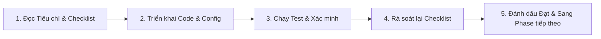

# HỆ THỐNG THU THẬP & PHÂN TÍCH BÌNH LUẬN BÀI VIẾT TIÊU CỰC (SOCIAL LISTENING COMMENTS)

> **Mục tiêu**: Tự động nhận diện các bài đăng có tính chất tiêu cực / khủng hoảng tâm lý trên mạng xã hội, tiến hành thu thập toàn bộ bình luận, dùng AI để phân tích tâm lý đám đông, trích xuất bằng chứng/địa điểm cụ thể và trực quan hóa chi tiết trên Dashboard phục vụ công tác ứng phó kịp thời của Nhà trường.

---

## 📌 Bảng Theo Dõi Tiến Độ Toàn Dự Án

| Phase | Tên Giai Đoạn | Trạng Thái | File Chi Tiết | Phụ Trách Kỹ Thuật |
| :---: | :--- | :---: | :--- | :--- |
| **Phase 1** | Cấu trúc Dữ liệu & Data Warehouse (BigQuery, dbt, Prisma) | 🟢 Completed | [`phase-1-warehouse-and-database.md`](./phase-1-warehouse-and-database.md) | BigQuery, dbt, PostgreSQL |
| **Phase 2** | Bộ Thu Thập Bình Luận Mục Tiêu (Targeted Crawler & Loader) | 🟡 Ready to Start | [`phase-2-crawler-engine.md`](./phase-2-crawler-engine.md) | Playwright, Node.js, BigQuery API |
| **Phase 3** | Xử Lý Trí Tuệ Nhân Tạo & Reverse ETL (Gemini AI & dlt) | ⚪ Pending Phase 2 | [`phase-3-ai-processing-reverse-etl.md`](./phase-3-ai-processing-reverse-etl.md) | Google Gemini, dlt, Prefect |
| **Phase 4** | Dịch Vụ Backend & API Cung Cấp Dữ Liệu | ⚪ Pending Phase 3 | [`phase-4-backend-api.md`](./phase-4-backend-api.md) | NestJS, Prisma Client, Swagger |
| **Phase 5** | Giao Diện Điều Tra Chi Tiết Đa Chiều (Deep-Dive UI) | ⚪ Pending Phase 4 | [`phase-5-frontend-deep-dive-ui.md`](./phase-5-frontend-deep-dive-ui.md) | Next.js 15, Tailwind, TanStack Query |

*Chú thích trạng thái: ⚪ Chưa bắt đầu | 🟡 Sẵn sàng triển khai | 🔵 Đang triển khai | 🟢 Đã hoàn thành & Đạt nghiệm thu*

---

## 🔄 Quy Trình Nghiệm Thu & Rà Soát (Audit Workflow)

Mỗi giai đoạn được thực hiện theo quy trình 4 bước nghiêm ngặt:

1. **Trước khi code**: Mở file tài liệu của Phase tương ứng để nắm rõ các yêu cầu kỹ thuật và Criteria.
2. **Trong khi code**: Bám sát cấu trúc bảng, tên trường, quy ước đặt tên (naming conventions) đã định nghĩa.
3. **Kiểm thử độc lập**: Chạy các script test, query dữ liệu, kiểm tra tính toàn vẹn (integrity) của phase đó.
4. **Nghiệm thu (Review Checklist)**: Đánh dấu `[x]` vào tất cả các mục tiêu đạt chuẩn trước khi chuyển sang giai đoạn tiếp theo.

---

## 📂 Danh Sách Tài Liệu Từng Giai Đoạn

1. [Phase 1: Warehouse & Database Schema](./phase-1-warehouse-and-database.md) - Thiết kế schema BigQuery, dbt staging/marts và Prisma PostgreSQL.
2. [Phase 2: Crawler Engine & BigQuery Loader](./phase-2-crawler-engine.md) - Kỹ thuật Playwright cào comments, bộ lọc "Tất cả bình luận", nạp dữ liệu thô.
3. [Phase 3: AI Processing & Reverse ETL](./phase-3-ai-processing-reverse-etl.md) - Đánh giá sentiment comment, tổng hợp dư luận (Comments Synthesis) và pipeline dlt.
4. [Phase 4: Backend API Services](./phase-4-backend-api.md) - Endpoints NestJS lấy danh sách comments, lọc theo cảm xúc, trigger crawl on-demand.
5. [Phase 5: Deep-Dive Frontend UI](./phase-5-frontend-deep-dive-ui.md) - Tái cấu trúc giao diện PostDetailDialog thành 2 cột với thống kê tỉ lệ và bộ lọc comment.
